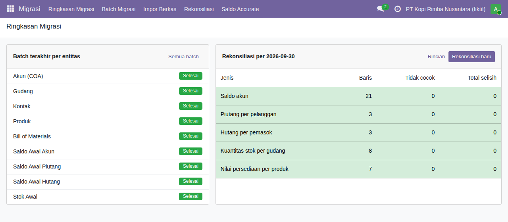
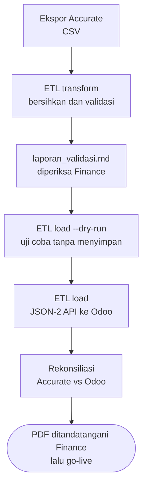

# Pindah-ERP

Migrasi ERP dari Accurate ke Odoo 19 Community, dikerjakan sebagai studi kasus untuk
**PT Kopi Rimba Nusantara**, produsen kopi bubuk kemasan. Perusahaan, data, NPWP, dan
angkanya fiktif.

Repo ini menunjukkan satu proyek migrasi utuh: analisis, migrasi data, rekonsiliasi,
modul custom, dan deployment. Pertanyaan yang dijawabnya: **apakah angka di Odoo sama
persis dengan angka di Accurate pada tanggal cutoff?**



## Isi repo

| Bagian | Isinya |
|---|---|
| `addons/jembatan_migration` | Modul Odoo: impor COA, gudang, kontak, produk, BoM, saldo awal, piutang/hutang terbuka, stok awal |
| `addons/jembatan_reconcile` | Modul Odoo: rekonsiliasi Accurate vs Odoo, laporan PDF (QWeb), dashboard (OWL) |
| `etl/` | ETL Python: baca ekspor Accurate, bersihkan, validasi, muat lewat JSON-2 API |
| `sample_data/accurate_export/` | Data contoh bergaya ekspor Accurate, sengaja berisi data kotor |
| `docs/` | Panduan setup, migrasi, deploy, dan rancangan (knowledge) |
| `scripts/` | Skrip setup database dan API key |

## Mulai cepat

Butuh Docker Desktop (atau Docker Engine + Compose) dan Python 3.11 ke atas.

```bash
git clone https://github.com/mfadlikurniawann-webdev/Pindah-ERP.git
cd Pindah-ERP
./scripts/setup.sh                 # Linux, macOS, atau Git Bash di Windows

cd etl
python -m pindah_etl transform     # baca ekspor Accurate -> etl/build/
python -m pindah_etl load --dry-run
python -m pindah_etl load
python -m pindah_etl reconcile     # hasil yang diharapkan: MATCH
```

Buka http://localhost:8069, login `admin` / `admin`, lalu segera ganti password.
Pengguna PowerShell dan penjelasan tiap langkah: [docs/setup-lokal.md](docs/setup-lokal.md).

## Alur migrasi



## Keputusan desain yang penting

**Kode akun Accurate dipertahankan.** Finance sudah hafal kodenya. Bagan akun `l10n_id`
tetap terpasang untuk pajak, tapi saldo masuk ke akun berkode Accurate.

**Piutang dan hutang masuk sebagai faktur terbuka, bukan angka jurnal.** Dengan begitu
aging, pelunasan, dan pengingat jatuh tempo langsung jalan di Odoo. Lawannya akun
penampung `399999`, yang harus kembali nol bila semua cocok.

**Nilai persediaan masuk lewat jurnal saldo awal; stok awal hanya kuantitas.** Odoo 19
memakai valuasi periodik secara bawaan, jadi penyesuaian stok tidak membuat jurnal ganda.

**Setiap impor aman diulang.** Kode Accurate disimpan sebagai jejak di `ir.model.data`,
sehingga menjalankan ulang memperbarui data, bukan menggandakannya.

**Angka yang tidak bisa dipercaya menghentikan pemuatan.** Neraca saldo tidak seimbang,
total faktur terbuka yang berbeda dari saldo akun, atau stok minus menjadi temuan `fatal`.

Alasan lengkap tiap aturan ada di [docs/knowledge/](docs/knowledge/README.md).

## Pengujian

| Lapisan | Perintah | Isi |
|---|---|---|
| ETL | `python -m pytest -q` | Parser angka Indonesia, NPWP, deduplikasi, kontrol saldo |
| Modul Odoo | `make test-odoo` | Impor, idempoten, dry run, saldo awal, rekonsiliasi, laporan |
| CI | GitHub Actions | Keduanya di setiap push, ditambah `ruff` |

## Dokumentasi

| Dokumen | Untuk siapa |
|---|---|
| [docs/setup-lokal.md](docs/setup-lokal.md) | Developer yang baru clone |
| [docs/panduan-migrasi.md](docs/panduan-migrasi.md) | Developer dan Finance saat migrasi sungguhan |
| [docs/deploy.md](docs/deploy.md) | Yang memasang Odoo di server |
| [docs/knowledge/](docs/knowledge/README.md) | Rancangan: apa yang dibangun dan kenapa |

## Lisensi

Modul dan kode di repo ini berlisensi LGPL-3, sama dengan Odoo Community. Proyek ini
independen dan tidak berafiliasi dengan Odoo S.A. maupun Accurate (CPSSoft).
