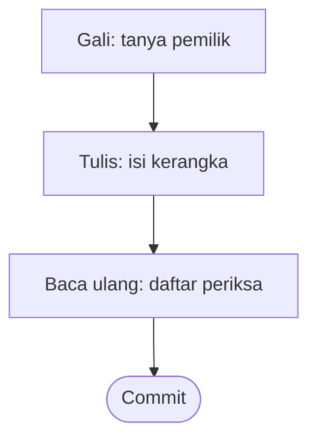
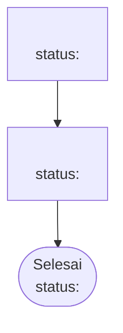

# Knowledge

Skill ini membantu menulis knowledge sebuah aplikasi: apa yang dibangun dan kenapa, sebelum kodenya
ditulis. Ia berlaku untuk aplikasi mana pun. Yang khas tiap aplikasi tinggal di repo knowledge-nya,
bukan di sini.

Seluruh cara kerjanya ada di berkas ini, termasuk kerangka tiap berkas. Contoh-contohnya diambil dari
satu aplikasi HR, sebagai contoh bentuk, bukan aturan untuk aplikasi lain. Untuk memakainya di aplikasi
lain, salin berkas ini ke `.claude/skills/knowledge/SKILL.md` di repo knowledge aplikasi itu.

## Isi repo knowledge

```
<aplikasi>-knowledge/
├── CLAUDE.md        pendek: menunjuk ke skill ini, hal yang sudah dipatok, prefix aturan
├── README.md        mulai di sini: apa aplikasinya, daftar isi, pola pikir, segi fitur, peran, istilah
├── plan.md          urutan pengerjaan, dan yang belum digali
├── domain/
│   ├── <bagian>.md  lima bagian: Skenario, Aturan, Data, Relasi data, Fitur
│   ├── <bagian>.md  bentuknya sama persis
│   └── ...
└── .claude/skills/knowledge/SKILL.md     berkas ini
```

Satu berkas di `domain/` adalah satu bagian aplikasi. Namanya huruf kecil, kata dipisah tanda hubung,
tanpa nomor, dan tanpa subfolder. Orang baru cukup tahu satu hal: tiap berkas di `domain/` punya lima
bagian yang sama, dalam urutan yang sama.

## Tiga langkah



Gali dan Tulis adalah dua giliran terpisah. Isi ditulis hanya sesudah pemilik menyuruh: "oke",
"kerjakan", "pakai itu". Pertanyaan pemilik bukan persetujuan. Kalau ragu, berarti belum.

## 1. Gali

| Permintaan | Contoh | Yang dilakukan |
|---|---|---|
| Ngobrol dulu | "aku mau diskusi ide recruitment, belum mau nulis" | Jawab, beri pendapat, dan bantah bila perlu. Tanpa wawancara, tanpa daftar perubahan |
| Aplikasi baru | Repo masih kosong, atau "mulai knowledge aplikasi X" | Empat hal dasar, sebelum bagian mana pun |
| Bagian baru | "gali bagian recruitment" | Tujuh pertanyaan, boleh lebih dari satu sesi |
| Ubah atau cabut aturan | "batas pengajuan sebaiknya diubah?" | Satu masalah sampai ada jawaban |
| Fitur baru | "tambah ekspor rekap" | Segi dan Yang membaik dulu, aturannya sesudah itu |
| Pindah dari bentuk lama | "pindahkan 02-plafon ke bentuk baru" | Tidak ada. Isinya tidak berubah, langsung Tulis |

Aturan giliran:

1. Paling banyak empat pertanyaan sekali giliran, lalu tunggu. Kirim lewat fitur tanya-jawab bila ada,
   dengan rekomendasi di urutan pertama.
2. Selalu beri rekomendasi. Pemilik lebih mudah mengoreksi usulan daripada mengarang dari nol.
3. Tanyakan kejadian nyata. Bukan "apa kardinalitasnya", tapi "satu pelamar bisa melamar dua lowongan?"
4. Kalau usulan pemilik lebih buruk, katakan apa yang rusak, lalu tawarkan gantinya.
5. Kalau pemilik sudah memutuskan, jangan bertanya ulang.
6. Jangan menebak. Yang belum dijawab masuk Belum diputuskan, satu baris.
7. Hal di luar pembahasan disebut sekali, lalu ditinggalkan.

Baca seperlunya sebelum menjawab: `README.md` dan `plan.md` untuk posisi umum, lalu berkas `domain/`
yang disebut. Jangan membaca seluruh repo untuk satu pertanyaan.

### Ngobrol dulu

Pemilik ingin berpikir keras, belum ingin menulis. Jawab, beri pendapat, dan boleh bertanya balik satu
atau dua. Begitu ada kalimat yang terdengar seperti keputusan, tawarkan: "Itu terdengar seperti
keputusan. Mau saya catat, atau kita lanjut ngobrol?"

Obrolan yang belum menjadi keputusan hilang saat sesi ditutup, dan itu disengaja. Dengan persetujuan
pemilik, poin yang sudah jelas boleh dicatat. Untuk calon bagian, tempatnya `plan.md`, kolom "Yang
sudah diketahui". Untuk bagian yang sudah ada, tempatnya Belum diputuskan di berkas itu.

### Aplikasi baru: empat hal dasar

Ditetapkan berurutan, sebelum bagian mana pun. Keempatnya menentukan seberapa rinci semua bagian nanti
ditulis.

| | Ditetapkan | Contoh pertanyaan | Ditulis di |
|:--:|---|---|---|
| 1 | Apa aplikasinya, dan siapa pemakainya | Masalah apa yang diselesaikan? Siapa membukanya tiap hari? | `README.md`: Apa aplikasinya, Peran |
| 2 | Pola pikir: apa yang mahal dibalik | Kesalahan apa yang tidak punya tombol urungkan? Uang salah transfer, keputusan atas nama orang yang salah, data bocor? | `README.md`: Pola pikir |
| 3 | Segi fitur | Kalau sebuah fitur berguna, ia memperbaiki apa? | `README.md`: Segi fitur |
| 4 | Bagian awal dan urutannya | Bagian apa yang pertama dipakai? Mana yang jadi sandaran bagian lain? | `plan.md` dan daftar isi `README.md` |

Hal yang dipatok pemilik di sepanjang langkah ini, misalnya "satu perusahaan", ditulis di `CLAUDE.md`
bagian Sudah dipatok. Sesi berikutnya tidak menanyakannya ulang.

Segi fitur dipilih tiga sampai enam kata yang tidak tumpang tindih. Contoh dari aplikasi HR: Uang,
Kontrol, Waktu, Kejelasan, Kepatuhan. Aplikasi yang tidak menyentuh uang tidak memakai "Uang".

### Bagian baru: tujuh pertanyaan

| | Digali | Contoh pertanyaan | Menjadi |
|:--:|---|---|---|
| 1 | Kenapa ada | Kalau ini tidak ada, apa yang rusak? | Pembuka berkas |
| 2 | Identitas | Apa yang membedakan satu dari yang lain? Apa yang tidak boleh berubah? | Data, Aturan |
| 3 | Isi | Data apa yang disimpan? Mana yang wajib? | Data |
| 4 | Hubungan | Data apa diambil dari bagian lain, dan apa yang dikirim? | Relasi data |
| 5 | Keadaan | Ada status apa saja? Pindah dari mana ke mana? | Data, Status |
| 6 | Yang ditolak | Apa yang tidak boleh terjadi? Apa yang pernah bikin masalah? | Aturan |
| 7 | Cara dipakai | Siapa melakukan apa, berurutan? Apa yang membaik? | Skenario, Fitur |

Pertanyaan 6 ditimbang dengan pola pikir di `README.md`. Makin mahal dibalik, makin rinci aturannya,
sampai ke kasus pinggir. Untuk bagian yang bukan benda, misalnya penutupan periode, ganti pertanyaan 2
sampai 4: apa pemicunya, apa langkahnya, siapa yang menjalankan, dan apa yang terjadi bila gagal.

### Menutup giliran Gali

Tutup dengan tiga hal, lalu berhenti tanpa menyentuh berkas:

1. Rekomendasi, beserta alasannya dan apa yang ditukar.
2. Daftar perubahan: berkas mana, bagian mana, aturan mana yang lahir, berubah, atau dicabut.
3. Pertanyaan: dikerjakan begitu?

Ngobrol dulu tidak ditutup begitu.

## 2. Tulis

| Isinya tentang | Ditulis di |
|---|---|
| Apa aplikasinya, pola pikir, segi fitur, peran, istilah | `README.md` |
| Konvensi untuk semua bagian: bentuk uang, tanggal, galat, daftar | `README.md`, Konvensi API |
| Hal yang sudah dipatok pemilik | `CLAUDE.md` |
| Urutan pengerjaan, dan calon bagian | `plan.md` |
| Siapa melakukan apa, berurutan | `domain/<bagian>.md`, Skenario |
| Aturan, alasan, penolakan | `domain/<bagian>.md`, Aturan |
| Medan dan status | `domain/<bagian>.md`, Data |
| Data dari atau ke bagian lain | `domain/<bagian>.md`, Relasi data |
| Fitur, endpoint, dan yang terasa di layar | `domain/<bagian>.md`, Fitur |

**Aplikasi baru.** Buat `CLAUDE.md`, `README.md`, `plan.md`, dan folder `domain/` dari kerangka di
bagian Kerangka, lalu isi dengan hasil empat hal dasar.

**Bagian baru.** Salin kerangka berkas domain ke `domain/<bagian>.md`. Tambahkan bagian itu ke daftar
isi `README.md`, dan prefix aturannya ke `CLAUDE.md`.

**Mengubah aturan.** Ubah bunyinya di tempat, dan isi Sejak dengan tanggal keputusan baru. Bunyi
lamanya ditulis di badan pesan commit, bukan di dokumen. Cari yang bersandar padanya dengan
`grep -rn "BR-XXX-NN" domain README.md`, lalu periksa Skenario dan Fitur yang merujuknya.

**Mencabut aturan.** Hapus barisnya. Pindahkan ke Yang dicabut hanya bila bentuk lamanya masih tertulis
di SOP atau dokumen lama, sehingga orang bisa menghidupkannya lagi. Nomornya tidak dipakai ulang.

**Pindah dari bentuk lama.** Bunyi Aturan dan Ditolak dengan disalin persis. Dari Kenapa, yang dibuang
hanya siapa memutus dan kapan, dan tanggalnya pindah ke Sejak. Satu berkas satu commit.

## Bentuk berkas domain

Lima bagian, selalu dalam urutan ini, lalu Belum diputuskan dan Yang dicabut di akhir.

### Skenario

Satu kalimat contoh konkret, misalnya "Dua Staff berangkat dari Bandar Lampung ke Semarang selama tiga
hari". Angka yang hidup di tabel lain, misalnya plafon, tidak disalin ke contoh.

Lalu satu flowchart jalan normal, dan tabel Bila tidak normal: `| Kejadian | Yang terjadi | Aturan |`.
Isi tabel itu cabang yang membuat uang atau kewenangan salah: ditolak, revisi, batal, penyetuju kosong.

### Aturan

```
| ID | Aturan | Kenapa | Sejak | Ditolak dengan |
|---|---|---|:--:|---|
```

- **ID** `BR-<PREFIX>-<NN>`, satu prefix per berkas, terdaftar di `CLAUDE.md`. Nomor tidak diurutkan
  ulang dan tidak dipakai ulang.
- **Aturan**: satu atau dua kalimat yang bisa dijawab benar atau salah.
- **Kenapa**: wajib. Alasan dan akibatnya bila dilanggar, kejadian yang membuktikannya, atau ongkos
  yang sengaja diterima. Siapa memutus dan kapan bukan alasan, jadi tidak ditulis di sini.
- **Sejak**: tanggal pemilik terakhir memutus bentuk aturan ini, `YYYY-MM-DD`, atau `—` bila tidak
  tercatat.
- **Ditolak dengan**: status HTTP dalam backtick beserta sebabnya, misalnya `` `403` bukan pengaju ``,
  atau `—`. Kode `error_code` milik repo backend, jadi tidak dikarang di sini.

Lebih dari sekitar lima belas aturan dikelompokkan dengan subjudul `###`. Tabel keputusan yang dipakai
banyak aturan, misalnya siapa penyetuju, ditaruh sebagai subjudul pertama di bagian ini.

### Data

`| Atribut | Wajib | Arti |`, satu tabel per benda. Wajib berisi `ya`, `tidak`, `server`, atau
syaratnya. Lalu subjudul Status: `| Keadaan | Artinya | Berpindah lewat |`, memuat semua perpindahan,
termasuk Tolak, Revisi, dan Batal.

### Relasi data

```
| Arah | Berkas | Data | Untuk |
|---|---|---|---|
```

Arah berisi Diambil atau Dikirim. Berkas berisi nama berkas `domain/` lain, atau layanan luar. Tulis
"Dipaku" bila nilainya disimpan di dokumen dan tidak ikut berubah sesudahnya. Bedanya penting bagi
backend, sebab yang dipaku harus disimpan.

### Fitur

```
| Fitur | Dipakai | Segi | Yang membaik |
|---|---|---|---|
```

Segi diambil dari kosakata di `README.md`. Yang membaik harus bisa dibuktikan salah. "Memudahkan HCGA"
tidak bisa. "Angka yang Finance cairkan sama dengan yang HCGA setujui" bisa. Kalau Yang membaik tidak
bisa diisi, fiturnya belum layak dibangun.

Lalu dua subjudul: Endpoint, `| Endpoint | Gunanya |`, dan Yang harus terasa di layar, paling banyak
empat butir.

### Diagram

- Selalu flowchart biasa dari atas ke bawah: `flowchart TD`, kotak dan panah lurus.
- Paling banyak sekitar delapan kotak. Jalan normal saja, kasus pinggir di tabel.
- Belah ketupat hanya untuk keputusan bercabang, misalnya siapa penyetuju.
- Tidak memakai diagram urutan, subgraph, atau garis yang saling silang.
- Tiap diagram diikuti kalimat: "Diagram ini turunan dari aturan yang dirujuknya. Kalau keduanya
  berbeda, aturan yang berlaku."

GitLab menampilkan diagram Mermaid sebagai gambar. Claude membacanya sebagai teks.

### Cara menulis

- Bahasa Indonesia sederhana. Nama tabel, medan, enum, dan endpoint selalu Inggris.
- Istilah teknis tidak diterjemahkan: `soft delete`, `audit trail`, `pagination`.
- Kalimat pendek, satu ide per kalimat, paling panjang 30 kata. Tanpa em dash.
- Jawabannya di depan, buktinya menyusul. Tabel untuk data sejajar, bukan untuk menata prosa.
- Hanya yang berlaku sekarang. Riwayat ada di `git log` dan pesan commit.
- Rujukan selalu dalam backtick: `BR-SPPD-21`, `pencairan`.
- Yang tidak ditulis di sini: DDL, tipe kolom, dan migrasi (milik repo backend), komponen, warna, route,
  dan persona (milik repo frontend), pembagian paket kerja, serta notulen diskusi.

## 3. Baca ulang

Tidak ada skrip pemeriksa. Sebelum commit, baca daftar ini:

1. Lima bagian ada, urut: Skenario, Aturan, Data, Relasi data, Fitur.
2. Tiap aturan punya Kenapa. Tanggal hanya ada di kolom Sejak.
3. Tiap `BR-` dan nama berkas yang dirujuk memang ada. Periksa dengan `grep`.
4. Diagram tampil di GitLab, dan jalan normalnya terbaca lurus.
5. Tiap Yang membaik bisa dibuktikan salah.
6. Saat memindahkan dari bentuk lama, bunyi aturan tidak bergeser. Periksa dengan
   `git diff --word-diff`: kolom Aturan tidak boleh berubah satu kata pun.
7. Baca berkasnya sekali dari atas, seolah orang baru. Sesudahnya, apakah ia tahu siapa melakukan apa?

Lalu commit: satu pembahasan satu commit. Badan pesannya menjelaskan apa yang berubah dan kenapa.

## Kerangka

Hapus baris `>` dan bagian yang kosong sebelum commit.

### `CLAUDE.md`

````markdown
# Repo knowledge <Nama Aplikasi>

Rancangan <Nama Aplikasi>: apa yang dibangun dan kenapa. Repo kode membacanya saat memecah pekerjaan.
Isinya hanya yang berlaku sekarang. Perubahan aturan mendarat di sini lebih dulu, baru di kode.

Semua pekerjaan di repo ini lewat `/knowledge`. Cara kerja dan bentuk tiap berkas ada di
`.claude/skills/knowledge/SKILL.md`.

## Prefix aturan

| Berkas | Prefix |
|---|---|

## Sudah dipatok, jangan ditanya ulang

> Diisi dari empat hal dasar, lalu bertambah setiap pemilik mematok hal baru.
````

### `README.md`

````markdown
# <Nama Aplikasi>

> Satu kalimat: apa aplikasinya. Lalu satu kalimat yang menyuruh membaca berkas ini dulu.

## Apa aplikasinya

> Masalah apa yang diselesaikan, siapa pemakainya, apa yang digantikan, dan batas sistemnya.

## Daftar isi

| Berkas | Isinya | Status |
|---|---|---|
| `domain/<bagian>.md` | <satu kalimat> | `digali`, `selesai`, atau `ditunda` |

## Pola pikir

> Yang mahal dibalik di aplikasi ini, satu butir per jenis, beserta contohnya. Makin mahal dibalik,
> makin rinci aturan di bagian yang menyentuhnya.

## Segi fitur

| Segi | Artinya |
|---|---|
| <segi> | <apa yang membaik bila sebuah fitur bersegi ini> |

## Peran

| Peran | Yang ia lakukan |
|---|---|

## Istilah

| Istilah | Di kode | Arti |
|---|---|---|

## Konvensi API

> Bentuk uang, tanggal, ID, galat, daftar, dan berkas yang berlaku untuk semua bagian.

## Belum diputuskan

Tidak ada.
````

### `plan.md`

````markdown
# Rencana

## Urutan pengerjaan

| # | Bagian | Kenapa di posisi ini |
|:--:|---|---|

## Yang belum digali

| Calon | Yang sudah diketahui | Kapan pantas dibuka |
|---|---|---|
````

### `domain/<bagian>.md`

````markdown
# <Nama Bagian>

> Dua sampai empat kalimat: apa ini dan kenapa ada. Sebut juga yang jelas tidak termasuk, dan di
> berkas mana ia berada.

## Skenario

> Satu kalimat contoh konkret.



Diagram ini turunan dari aturan yang dirujuknya. Kalau keduanya berbeda, aturan yang berlaku.

### Bila tidak normal

| Kejadian | Yang terjadi | Aturan |
|---|---|---|

## Aturan

| ID | Aturan | Kenapa | Sejak | Ditolak dengan |
|---|---|---|:--:|---|

## Data

| Atribut | Wajib | Arti |
|---|:--:|---|

### Status

| Keadaan | Artinya | Berpindah lewat |
|---|---|---|

## Relasi data

| Arah | Berkas | Data | Untuk |
|---|---|---|---|

## Fitur

| Fitur | Dipakai | Segi | Yang membaik |
|---|---|---|---|

### Endpoint

| Endpoint | Gunanya |
|---|---|

### Yang harus terasa di layar

## Belum diputuskan

Tidak ada.

## Yang dicabut

| Yang dicabut | Dicabut | Kenapa jangan dihidupkan | Yang berlaku |
|---|:--:|---|---|
````
