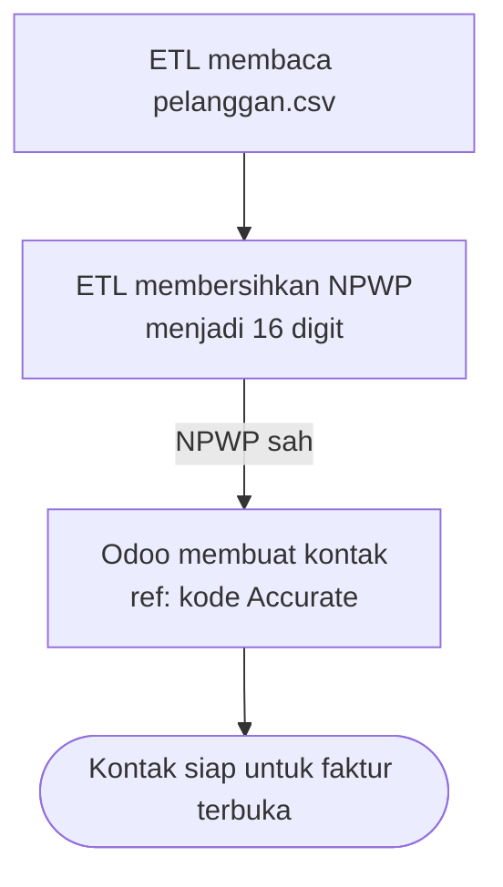

# Kontak

Pelanggan dan pemasok dari Accurate, termasuk NPWP dan status PKP. Akun piutang dan
hutangnya diatur di `saldo-awal`.

## Skenario

CV Sumber Rezeki Kopi tercatat di Accurate dengan NPWP lama 15 digit bertitik dan strip.

Diagram ini turunan dari aturan yang dirujuknya. Kalau keduanya berbeda, aturan yang berlaku.

### Bila tidak normal

| Kejadian | Yang terjadi | Aturan |
|---|---|---|
| NPWP salah ketik | Kontak ditolak | `BR-KONTAK-04` |
| PKP tanpa NPWP | Kontak ditolak | `BR-KONTAK-03` |
| Kontak ditolak punya faktur terbuka | Pemuatan berhenti | `BR-SALDO-04` |

## Aturan

| ID | Aturan | Kenapa | Sejak | Ditolak dengan |
|---|---|---|:--:|---|
| BR-KONTAK-01 | Kode Accurate disimpan di kolom Referensi kontak. | Finance mencari kontak dengan kode lama, dan rekonsiliasi per kontak memakai kode itu. | 2026-10-29 | — |
| BR-KONTAK-02 | NPWP disimpan 16 digit tanpa tanda baca. NPWP lama 15 digit diberi 0 di depan. | Format 16 digit berlaku sejak 2024 dan dipakai Coretax. | 2026-10-29 | — |
| BR-KONTAK-03 | Kontak berstatus PKP wajib punya NPWP. | e-Faktur untuk PKP tanpa NPWP ditolak Coretax, dan ketahuannya baru saat faktur pertama. | 2026-10-29 | `rejected` |
| BR-KONTAK-04 | NPWP berawalan 0 harus lolos checksum Luhn pada 9 digit nomor lama. NPWP 16 digit tanpa awalan 0 diterima tanpa checksum. | Sama dengan validasi Odoo. Menolak di ETL memberi pesan yang jelas, bukan galat Odoo per baris. | 2026-10-29 | `rejected` |

## Data

| Atribut | Wajib | Arti |
|---|:--:|---|
| `code` | ya | Kode Accurate, disimpan di `ref` |
| `name` | ya | Nama |
| `rank` | ya | `customer` atau `supplier` |
| `vat` | bila PKP | NPWP 16 digit |
| `is_pkp` | ya | Status PKP, disimpan di `l10n_id_pkp` |
| `receivable_account_code`, `payable_account_code` | ya | Akun bawaan, dari `config.toml` |

### Status

Kontak tidak punya status sendiri.

## Relasi data

| Arah | Berkas | Data | Untuk |
|---|---|---|---|
| Diambil | `migrasi` | Akun piutang dan hutang | Akun bawaan kontak |
| Dikirim | `saldo-awal` | Kontak | Faktur terbuka |
| Dikirim | `rekonsiliasi` | Kode di `ref` | Kunci piutang dan hutang per kontak |

## Fitur

| Fitur | Dipakai | Segi | Yang membaik |
|---|---|---|---|
| Normalisasi NPWP | Developer | Kepatuhan | Semua NPWP di Odoo 16 digit dan lolos validasi |
| Penolakan NPWP salah | Finance | Kejelasan | NPWP salah ketik ketahuan sebelum go-live, bukan saat e-Faktur ditolak |

### Endpoint

| Endpoint | Gunanya |
|---|---|
| `api_import` dengan `entity` = `partner` | Muat kontak |

### Yang harus terasa di layar

- Kode Accurate tampil di kolom Referensi kontak.

## Belum diputuskan

- Apakah alamat kirim yang berbeda dari alamat penagihan ikut dipindah sebagai kontak anak.
