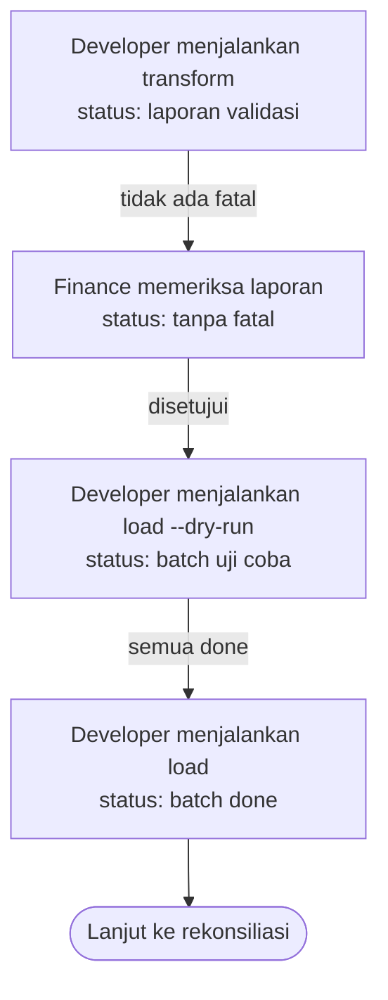

# Migrasi

Cara data Accurate masuk ke Odoo: urutan, jejak sumber, menjalankan ulang, dan uji coba.
Bagian ini tidak mengatur isi tiap entitas. Isi kontak ada di `kontak`, saldo di
`saldo-awal`, stok di `stok-awal`.

Di kolom Ditolak dengan, `fatal` berarti ETL menghentikan pemuatan, dan `galat batch`
berarti baris itu gagal di Odoo dan tercatat di log batch.

## Skenario

Developer memuat ekspor Accurate PT Kopi Rimba Nusantara per 30 September 2026 ke
database uji, lalu ke produksi.

Diagram ini turunan dari aturan yang dirujuknya. Kalau keduanya berbeda, aturan yang berlaku.

### Bila tidak normal

| Kejadian | Yang terjadi | Aturan |
|---|---|---|
| Laporan validasi berisi fatal | `load` menolak berjalan | `BR-MIG-03` |
| Satu baris gagal di Odoo | Baris lain tetap masuk, batch berstatus Sebagian galat | `BR-MIG-08` |
| `load` dijalankan ulang | Data diperbarui atau dilewati, tidak digandakan | `BR-MIG-01` |
| Record dihapus manual di Odoo | Jejak sumbernya ikut dibersihkan, muat ulang membuat record baru | `BR-MIG-01` |
| Kode sama, isi berbeda di ekspor | Kedua baris ditolak | `BR-MIG-02` |

## Aturan

| ID | Aturan | Kenapa | Sejak | Ditolak dengan |
|---|---|---|:--:|---|
| BR-MIG-01 | Setiap record hasil impor dipasangkan dengan kode Accurate-nya. Impor berikutnya dengan kode yang sama memperbarui atau melewati record itu. | Migrasi selalu diulang beberapa kali. Tanpa pasangan kode, setiap pengulangan menggandakan kontak dan faktur. | 2026-10-29 | — |
| BR-MIG-02 | Duplikat persis di ekspor dibuang. Kode yang sama dengan isi berbeda menolak kedua baris. | Duplikat persis lazim di ekspor Excel. Kode ganda dengan isi berbeda berarti salah satunya keliru, dan ETL tidak bisa memilih. | 2026-10-29 | `rejected` |
| BR-MIG-03 | Pemuatan tidak berjalan selama laporan validasi berisi temuan fatal. | Saldo awal yang salah merusak semua laporan sesudah go-live, dan sulit dilacak kemudian. | 2026-10-29 | `fatal` |
| BR-MIG-04 | Saldo awal, faktur terbuka piutang, dan hutang memakai jurnal khusus `MIG`, `MIGAR`, dan `MIGAP`. | Nomor faktur operasional pertama di Odoo tetap mulai dari awal, dan dokumen migrasi mudah disaring. | 2026-10-29 | — |
| BR-MIG-05 | Uji coba seluruh migrasi berjalan dalam satu transaksi, lalu dibatalkan bersama. | Entitas belakang butuh hasil entitas depan. Uji coba per entitas selalu gagal di kontak karena akunnya sudah dibatalkan. | 2026-10-29 | — |
| BR-MIG-06 | Kode akun Accurate dipakai sebagai kode akun Odoo. | Finance sudah hafal kodenya, dan rekonsiliasi per akun jadi langsung. | 2026-10-29 | — |
| BR-MIG-07 | Akun yang sudah ada dengan tipe berbeda dari sumber tidak diubah. | Mengubah tipe akun yang sudah dipakai mengubah laporan dan penutupan tahun. | 2026-10-29 | `galat batch` |
| BR-MIG-08 | Untuk data induk, satu baris gagal tidak membatalkan baris lain di batch yang sama. | Galat bisa diperbaiki satu per satu lalu batch diulang. Aman karena `BR-MIG-01`. | 2026-10-29 | — |

## Data

### Batch migrasi (`jembatan.migration.batch`)

| Atribut | Wajib | Arti |
|---|:--:|---|
| `entity` | ya | Entitas yang dimuat |
| `dry_run` | ya | Uji coba atau sungguhan |
| `row_count`, `created_count`, `updated_count`, `skipped_count`, `error_count` | server | Hitungan hasil |
| `log_ids` | server | Catatan per baris: tingkat, kode sumber, pesan |

### Status

| Keadaan | Artinya | Berpindah lewat |
|---|---|---|
| `draft` | Baru dibuat, belum dijalankan | Pembuatan batch |
| `done` | Semua baris berhasil | Selesai tanpa galat |
| `partial` | Sebagian baris galat | Selesai dengan galat dan ada baris berhasil |
| `failed` | Tidak ada baris berhasil | Selesai dan semua baris galat |

## Relasi data

| Arah | Berkas | Data | Untuk |
|---|---|---|---|
| Dikirim | `kontak` | Akun piutang dan hutang | Akun bawaan kontak |
| Dikirim | `saldo-awal` | Akun, kontak | Jurnal dan faktur terbuka |
| Dikirim | `stok-awal` | Produk, gudang | Penyesuaian stok |
| Dikirim | `rekonsiliasi` | Status batch terakhir | Dashboard |

## Fitur

| Fitur | Dipakai | Segi | Yang membaik |
|---|---|---|---|
| Laporan validasi | Developer, Finance | Kejelasan | Finance tahu baris mana yang ditolak dan kenapa, sebelum ada data masuk |
| Uji coba menyeluruh | Developer | Keamanan ulang | Semua galat ketahuan tanpa satu record pun tersimpan |
| Impor aman diulang | Developer | Keamanan ulang | Menjalankan `load` dua kali menghasilkan jumlah record yang sama |
| Impor lewat layar | Finance | Kejelasan | Migrasi bisa jalan tanpa terminal |

### Endpoint

| Endpoint | Gunanya |
|---|---|
| `POST /json/2/jembatan.migration.batch/api_import` | Muat satu entitas |
| `POST /json/2/jembatan.migration.batch/api_import_many` | Muat beberapa entitas, termasuk uji coba menyeluruh |

### Yang harus terasa di layar

- Batch gagal dan sebagian galat tampil merah dan kuning di daftar.
- Log galat menyebut kode Accurate, bukan ID Odoo.
- Wizard impor mencentang Uji coba secara bawaan.

## Belum diputuskan

Tidak ada.
