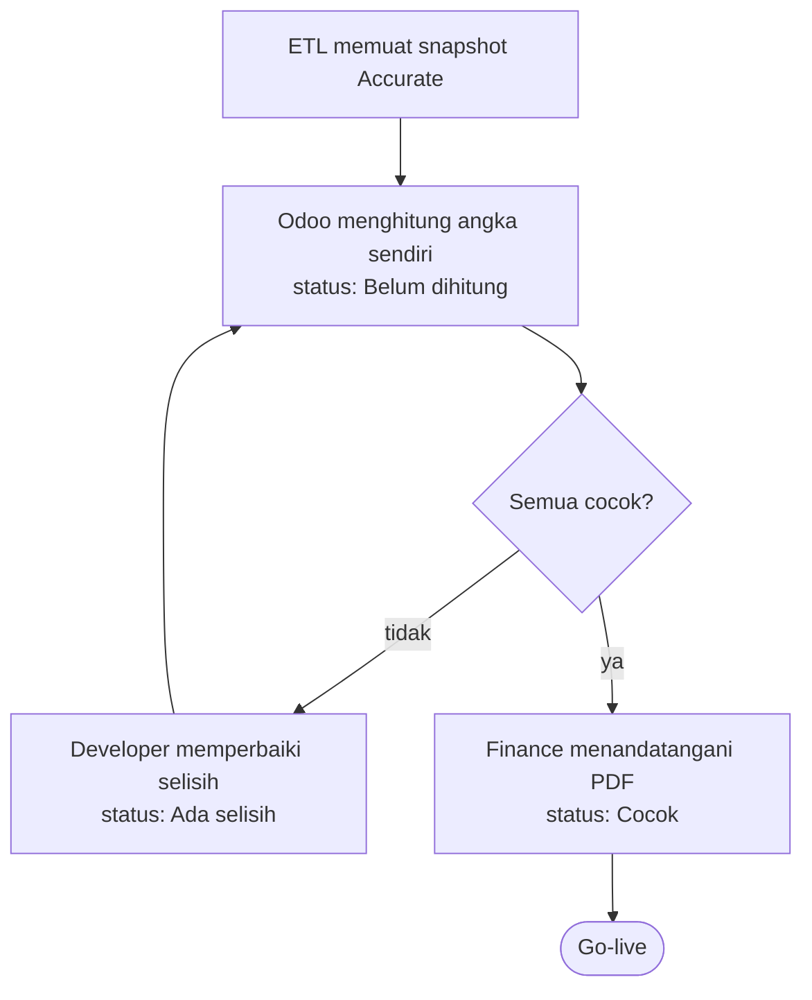

# Rekonsiliasi

Bukti bahwa angka Odoo sama dengan angka Accurate per tanggal cutoff. Hasilnya menjadi
syarat go-live.

## Skenario

Finance membandingkan neraca saldo, piutang, hutang, dan stok PT Kopi Rimba Nusantara
per 30 September 2026.

Diagram ini turunan dari aturan yang dirujuknya. Kalau keduanya berbeda, aturan yang berlaku.

### Bila tidak normal

| Kejadian | Yang terjadi | Aturan |
|---|---|---|
| Akun penampung tidak nol | Muncul sebagai Tidak ada di Accurate | `BR-SALDO-03` |
| Snapshot dimuat ulang | Snapshot lama jenis yang sama diganti | `BR-REK-04` |
| Ada satu baris selisih | Status Ada selisih, go-live ditunda | `BR-REK-03` |

## Aturan

| ID | Aturan | Kenapa | Sejak | Ditolak dengan |
|---|---|---|:--:|---|
| BR-REK-01 | Semua angka uang memakai tanda debit dikurangi kredit. Hutang, modal, dan pendapatan bernilai negatif. | Satu konvensi untuk semua jenis mencegah selisih palsu karena salah tanda. | 2026-10-29 | — |
| BR-REK-02 | Angka dianggap cocok bila selisihnya nol menurut pembulatan mata uang, dan kuantitas bila selisihnya di bawah 0,0001. | Saldo awal tidak punya alasan untuk berbeda, jadi toleransi lebih longgar hanya menyembunyikan kesalahan. | 2026-10-29 | — |
| BR-REK-03 | Go-live hanya bila status Cocok dan PDF rekonsiliasi ditandatangani Finance. | Tanda tangan memindahkan tanggung jawab angka ke Finance, yang memahami angkanya. | 2026-10-29 | — |
| BR-REK-04 | Memuat snapshot mengganti seluruh snapshot lama untuk jenis yang dimuat. | Snapshot campuran dari dua ekspor menghasilkan selisih yang tidak bisa dijelaskan. | 2026-10-29 | — |

## Data

| Atribut | Wajib | Arti |
|---|:--:|---|
| `kind` | ya | `account`, `receivable`, `payable`, `stock_qty`, `stock_value` |
| `key` | ya | Kode akun, kode kontak, kode produk, atau `produk@gudang` |
| `amount` | ya | Angka Accurate, tanda menurut `BR-REK-01` |

### Status

| Keadaan | Artinya | Berpindah lewat |
|---|---|---|
| `draft` | Belum dihitung | Rekonsiliasi dibuat |
| `match` | Semua baris cocok | Hitung |
| `mismatch` | Ada baris tidak cocok | Hitung |

Status per baris: `match`, `diff`, `missing_odoo`, `missing_source`.

## Relasi data

| Arah | Berkas | Data | Untuk |
|---|---|---|---|
| Diambil | `saldo-awal` | Saldo per akun dan per kontak | Angka Odoo |
| Diambil | `stok-awal` | Kuantitas per gudang, nilai per produk | Angka Odoo |
| Diambil | `migrasi` | Status batch terakhir | Dashboard |

## Fitur

| Fitur | Dipakai | Segi | Yang membaik |
|---|---|---|---|
| Rekonsiliasi lima jenis | Developer, Finance | Kebenaran | Setiap selisih tampil dengan kode, angka Accurate, angka Odoo, dan besarnya |
| PDF bertanda tangan | Finance | Kejelasan | Ada satu dokumen yang menyatakan migrasi diterima |
| Dashboard | Developer, Finance | Kejelasan | Status semua batch dan hasil rekonsiliasi terlihat di satu layar |

### Endpoint

| Endpoint | Gunanya |
|---|---|
| `POST /json/2/jembatan.source.balance/api_load` | Muat snapshot Accurate |
| `POST /json/2/jembatan.reconcile.run/api_run` | Hitung dan kembalikan baris tidak cocok |

### Yang harus terasa di layar

- Baris tidak cocok tampil merah dan bisa disaring.
- PDF memuat ringkasan per jenis, rincian selisih, dan kolom tanda tangan.

## Belum diputuskan

Tidak ada.
