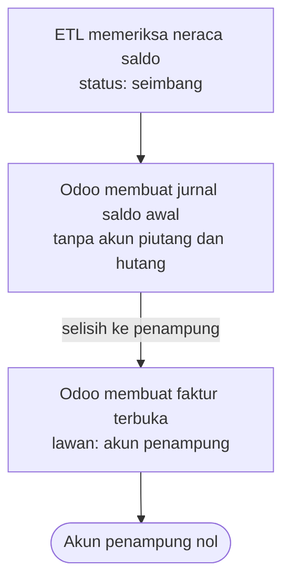

# Saldo Awal

Saldo setiap akun per tanggal cutoff, dan faktur yang belum lunas. Nilai persediaan ikut
di jurnal saldo awal; kuantitasnya diatur di `stok-awal`.

## Skenario

PT Kopi Rimba Nusantara punya piutang Rp 44.210.000 dari lima faktur dan hutang
Rp 51.740.000 dari tiga faktur per 30 September 2026.

Diagram ini turunan dari aturan yang dirujuknya. Kalau keduanya berbeda, aturan yang berlaku.

### Bila tidak normal

| Kejadian | Yang terjadi | Aturan |
|---|---|---|
| Neraca saldo tidak seimbang | Pemuatan berhenti | `BR-SALDO-08` |
| Total faktur terbuka beda dengan saldo akun | Pemuatan berhenti | `BR-SALDO-04` |
| Jurnal saldo awal dimuat ulang | Dilewati, jurnal lama tetap | `BR-SALDO-02` |
| Sisa faktur negatif | Dibuat sebagai nota kredit | `BR-SALDO-07` |
| Neraca saldo memuat akun piutang di jurnal | Jurnal ditolak utuh | `BR-SALDO-05` |

## Aturan

| ID | Aturan | Kenapa | Sejak | Ditolak dengan |
|---|---|---|:--:|---|
| BR-SALDO-01 | Semua saldo awal bertanggal cutoff, yaitu hari terakhir transaksi di Accurate. | Neraca Odoo per cutoff harus sama dengan neraca Accurate per tanggal yang sama. | 2026-10-29 | — |
| BR-SALDO-02 | Jurnal saldo awal dibuat sekali. Memuat ulang melewatinya; untuk menggantinya, jurnal lama dibatalkan dan dihapus dulu. | Dua jurnal saldo awal menggandakan seluruh neraca. | 2026-10-29 | — |
| BR-SALDO-03 | Lawan jurnal saldo awal dan faktur terbuka adalah satu akun penampung, yang harus nol setelah semuanya dimuat. | Penampung yang tidak nol adalah bukti cepat bahwa piutang atau hutang tidak cocok dengan neraca. | 2026-10-29 | — |
| BR-SALDO-04 | Total sisa faktur terbuka sama dengan saldo akun piutang atau hutang di neraca saldo, dan setiap fakturnya punya kontak yang ikut dimigrasi. | Selisih berarti ada jurnal langsung ke akun piutang di Accurate, atau saldo yang hilang bersama kontak yang ditolak. | 2026-10-29 | `fatal` |
| BR-SALDO-05 | Akun piutang dan hutang usaha tidak masuk jurnal saldo awal. Saldonya masuk lewat faktur terbuka. | Faktur memberi aging, pelunasan, dan pengingat jatuh tempo. Angka jurnal tidak bisa dilunasi per faktur. | 2026-10-29 | `galat batch` |
| BR-SALDO-06 | Faktur terbuka menyimpan tanggal faktur dan jatuh tempo asli, tapi tanggal jurnalnya cutoff. | Aging tetap benar, dan tidak ada jurnal di periode yang masih dipegang Accurate. | 2026-10-29 | — |
| BR-SALDO-07 | Sisa negatif dibuat sebagai nota kredit. | Retur dan kelebihan bayar yang belum dipakai harus bisa dipasangkan ke faktur berikutnya. | 2026-10-29 | — |
| BR-SALDO-08 | Neraca saldo sumber harus seimbang. | Neraca tidak seimbang berarti ekspor terpotong atau tersaring. | 2026-10-29 | `fatal` |

## Data

### Baris jurnal saldo awal

| Atribut | Wajib | Arti |
|---|:--:|---|
| `date` | ya | Tanggal cutoff |
| `account_code` | ya | Kode akun |
| `debit`, `credit` | ya | Salah satunya terisi |
| `suspense_account_code` | ya | Akun penampung |

### Faktur terbuka

| Atribut | Wajib | Arti |
|---|:--:|---|
| `number` | ya | Nomor faktur Accurate, disimpan di Referensi |
| `partner_code` | ya | Kode kontak |
| `invoice_date`, `due_date` | ya | Tanggal asli |
| `date` | ya | Tanggal cutoff |
| `amount` | ya | Sisa yang belum dibayar; negatif untuk nota kredit |

### Status

Faktur terbuka langsung berstatus `posted`. Lunas mengikuti alur pembayaran Odoo biasa.

## Relasi data

| Arah | Berkas | Data | Untuk |
|---|---|---|---|
| Diambil | `migrasi` | Akun, jurnal khusus | Baris jurnal |
| Diambil | `kontak` | Kontak | Faktur terbuka |
| Dikirim | `stok-awal` | Saldo akun persediaan | Pembanding nilai stok |
| Dikirim | `rekonsiliasi` | Saldo per akun dan per kontak | Perbandingan |

## Fitur

| Fitur | Dipakai | Segi | Yang membaik |
|---|---|---|---|
| Faktur terbuka | Finance | Kebenaran | Aging piutang di Odoo sama dengan di Accurate pada hari pertama |
| Akun penampung | Developer | Kebenaran | Selisih piutang atau hutang terlihat dari satu saldo akun |

### Endpoint

| Endpoint | Gunanya |
|---|---|
| `api_import` dengan `entity` = `opening_balance` | Jurnal saldo awal |
| `api_import` dengan `entity` = `opening_receivable` atau `opening_payable` | Faktur terbuka |

### Yang harus terasa di layar

- Faktur terbuka mudah disaring lewat jurnal Saldo Awal Piutang dan Saldo Awal Hutang.
- Nomor faktur Accurate muncul di Referensi dan Referensi Pembayaran.

## Belum diputuskan

- Aset tetap dipindah sebagai saldo akun saja, atau per aset dengan jadwal penyusutan.

## Yang dicabut

| Yang dicabut | Dicabut | Kenapa jangan dihidupkan | Yang berlaku |
|---|:--:|---|---|
| Memuat ulang jurnal saldo awal menghasilkan galat | 2026-10-29 | Membuat `load` gagal setiap diulang, padahal entitas lain aman diulang | `BR-SALDO-02` |
