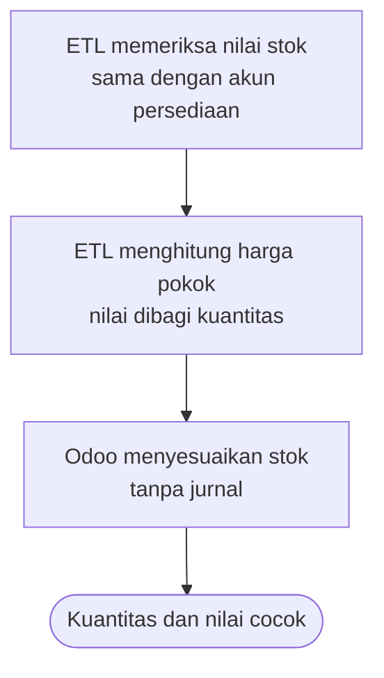

# Stok Awal

Kuantitas persediaan per barang per gudang, dan harga pokoknya. Nilai rupiahnya masuk
lewat jurnal di `saldo-awal`.

## Skenario

Gudang Pabrik menyimpan 800 kg biji kopi robusta senilai Rp 44.000.000 per 30 September 2026.

Diagram ini turunan dari aturan yang dirujuknya. Kalau keduanya berbeda, aturan yang berlaku.

### Bila tidak normal

| Kejadian | Yang terjadi | Aturan |
|---|---|---|
| Stok minus | Pemuatan berhenti | `BR-STOK-01` |
| Nilai stok beda dengan akun persediaan | Pemuatan berhenti | `BR-STOK-04` |
| Kategori produk memakai valuasi perpetual | Baris ditolak | `BR-STOK-02` |
| Kuantitas nol | Baris dilewati | `BR-STOK-05` |

## Aturan

| ID | Aturan | Kenapa | Sejak | Ditolak dengan |
|---|---|---|:--:|---|
| BR-STOK-01 | Stok minus tidak dimigrasi. | Stok minus berarti barang keluar sebelum masuk tercatat. Nilainya tidak bermakna dan harus dibereskan di Accurate. | 2026-10-29 | `fatal` |
| BR-STOK-02 | Penyesuaian stok awal tidak membuat jurnal. Produknya harus berkategori valuasi periodik. | Nilainya sudah masuk di jurnal saldo awal. Jurnal kedua menggandakan persediaan. | 2026-10-29 | `galat batch` |
| BR-STOK-03 | Harga pokok produk adalah total nilai dibagi total kuantitas di semua gudang. | Accurate memakai biaya rata-rata per barang, bukan per gudang. | 2026-10-29 | — |
| BR-STOK-04 | Total nilai stok awal sama dengan saldo akun bertipe Persediaan di neraca saldo. | Selisih berarti ekspor stok tidak per cutoff, atau ada jurnal manual ke akun persediaan. | 2026-10-29 | `fatal` |
| BR-STOK-05 | Baris berkuantitas nol dilewati. | Tidak ada yang perlu disesuaikan, dan Odoo menolak penyesuaian nol. | 2026-10-29 | — |

## Data

| Atribut | Wajib | Arti |
|---|:--:|---|
| `product_code` | ya | Kode barang |
| `warehouse_code` | ya | Kode gudang, paling panjang 5 karakter |
| `quantity` | ya | Lebih dari nol, dalam satuan produk |

### Status

Penyesuaian langsung diterapkan. Tidak ada status antara.

## Relasi data

| Arah | Berkas | Data | Untuk |
|---|---|---|---|
| Diambil | `migrasi` | Produk, gudang | Lokasi dan barang |
| Diambil | `saldo-awal` | Saldo akun persediaan | Pembanding nilai |
| Dikirim | `rekonsiliasi` | Kuantitas per gudang, nilai per produk | Perbandingan |

## Fitur

| Fitur | Dipakai | Segi | Yang membaik |
|---|---|---|---|
| Stok awal tanpa jurnal | Developer | Kebenaran | Saldo akun persediaan sesudah migrasi sama persis dengan neraca saldo |

### Endpoint

| Endpoint | Gunanya |
|---|---|
| `api_import` dengan `entity` = `opening_stock` | Stok awal |

### Yang harus terasa di layar

- Kuantitas tersedia per gudang tampil sama dengan laporan stok Accurate.

## Belum diputuskan

- Kapan kategori produk diubah ke valuasi perpetual sesudah go-live.
- Apakah stok dengan nomor lot atau tanggal kedaluwarsa perlu dipindah per lot.
